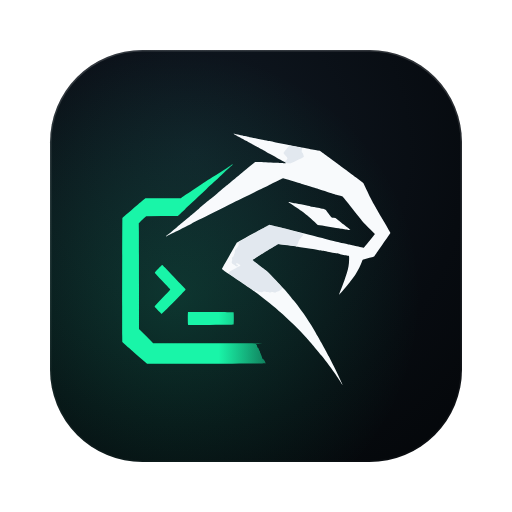
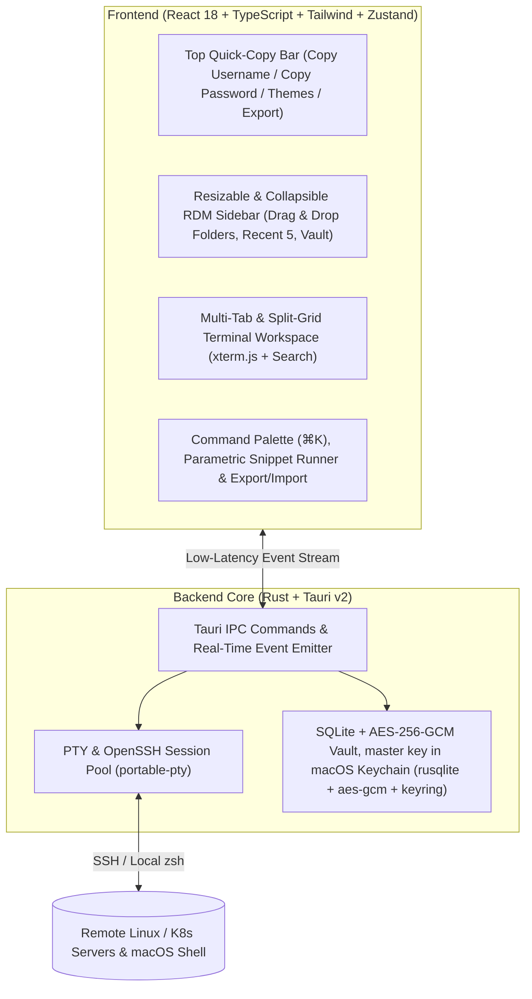

<div align="center">



<br />
<br />

<picture>
  <source media="(prefers-color-scheme: dark)" srcset="./public/soliton-font-white.png" />
  <source media="(prefers-color-scheme: light)" srcset="./public/soliton-font-dark.png" />
  
</picture>

<br />
<br />

**Next-Generation Hybrid SSH & Remote Server Manager for macOS**  
*Combining the modern terminal UX of **Termius** with the enterprise Vault & folder hierarchy of **Remote Desktop Manager (RDM)**.*

[](https://v2.tauri.app/)
[](https://www.rust-lang.org/)
[](https://react.dev/)
[](./SECURITY.md)
[](https://github.com/solitonhq/soliton-term/actions/workflows/ci.yml)
[](./LICENSE)

</div>

---

## 🌟 Overview

**Soliton Term** is a lightweight, native-speed macOS SSH & Remote Server Manager engineered with **Rust (Tauri v2)** and **React + xterm.js**. It solves the biggest pain point for SREs, DevOps engineers, and system administrators: choosing between a visually modern terminal client (like *Termius*) and a structured credential/folder manager (like *Devolutions Remote Desktop Manager*).

---

## ✨ Key Features

| Feature | Description |
| :--- | :--- |
| 🎨 **3 Application Themes** | Instant zero-flicker switching between **Dark Blue** (*Termius Default*), **Dark Black** (*OLED Pitch Black*), and **Light** (*Clean macOS*). |
| 🌈 **11+ Terminal Palettes** | Built-in schemes including *Soliton Cyber, Termius Dark, Dracula, Tokyo Night, OLED Pitch, Catppuccin Mocha, Nord Polar, Monokai Pro, Matrix Hacker, Solarized Light*, and *Clean Light*. |
| 🔐 **RDM-Style Quick Copy Bar** | Top navigation panel detects the active server's linked Vault Credential and provides one-click **`Copy Username`**, **`Copy Password`**, and **`Copy IP:Port`** buttons. |
| 📁 **Drag & Drop Folder Tree & Recent Sessions** | Add servers directly under nested folders, reorganize servers via **Drag & Drop**, resize or collapse the sidebar, and quickly reconnect to your **Last 5 Recent Sessions**. |
| 🛡️ **Keychain-Backed Encrypted Vault** | Reusable credential pool (Passwords & Ed25519/RSA SSH Keys) encrypted at rest with **AES-256-GCM** in a local SQLite database. The master key lives in the **macOS Keychain**, never on disk. See [`SECURITY.md`](./SECURITY.md). |
| 🔄 **Full Workspace Export & Import** | Export all your servers, folders, credentials (optional), snippets, and aliases to a `.json` bundle to back up or share with teammates, and import shared bundles in one click. |
| 📡 **Selective Multi-Execution (Broadcast)** | Execute commands across all open SSH tabs or a cherry-picked subset of servers simultaneously in a synchronized split-grid view. Batch-open entire folders with one click. |
| 📜 **Parametric Snippet Pool** | Store reusable diagnostic and operational scripts. Dynamic placeholders like `{{namespace}}`, `{{service_name}}`, or `{{port}}` automatically prompt for values before execution. |
| 🪄 **Session-Only Temporary Alias Injector** | Inject your personal aliases (`ll`, `k`, `dcu`, `ports`) into remote SSH sessions **in-memory** (`export HISTCONTROL=ignorespace`) without ever modifying remote `~/.bashrc`, `~/.zshrc`, or `.bash_history` files. |
| ⌨️ **`⌘K` Global Command Palette** | Connect to any host, copy Vault secrets, run snippets, inject aliases, or switch themes in milliseconds without lifting your hands from the keyboard. |

---

## 💿 Install

1. Download the latest `Soliton Term_<version>_aarch64.dmg` (Apple Silicon) or `_x64.dmg` (Intel) from the [**Releases**](https://github.com/solitonhq/soliton-term/releases) page.
2. Open the DMG and drag **Soliton Term** into **Applications**.
3. *(Unsigned builds only)* If macOS Gatekeeper blocks the first launch, clear the quarantine flag:
   ```bash
   xattr -cr "/Applications/Soliton Term.app"
   ```

On first launch your vault is empty: add a server, open a local terminal, or import a workspace bundle. If you used an earlier build, its master key is moved into the Keychain automatically (macOS may ask permission once).

---

## 🛠️ Building from Source

### Prerequisites
- **macOS** (Apple Silicon M1/M2/M3/M4 or Intel)
- **Node.js** `v20+`
- **Rust** stable (`rustup default stable`)

### 1. Clone & Install Dependencies
```bash
git clone https://github.com/solitonhq/soliton-term.git
cd soliton-term
npm install
```

### 2. Run in Development Mode
```bash
# Run the native macOS Tauri v2 desktop window with live reload:
npm run tauri dev

# Or run the UI in browser/Vite preview mode:
npm run dev
```

### 3. Run the Checks
```bash
npm run typecheck && npm test          # frontend
cd src-tauri && cargo fmt --check && cargo clippy --all-targets -- -D warnings && cargo test
```

### 4. Build Production macOS `.app` & `.dmg` Installer
```bash
npm run tauri build
```
This produces:
- **macOS Application Bundle:** `src-tauri/target/release/bundle/macos/Soliton Term.app`
- **macOS DMG Disk Image:** `src-tauri/target/release/bundle/dmg/Soliton Term_<version>_<arch>.dmg`

---

## 🏗️ System Architecture



---

## 🪄 How Temporary Alias Injection Works

When managing shared production servers, modifying `~/.bashrc` or `~/.zshrc` with personal aliases is bad practice. **Soliton Term** solves this by injecting your enabled aliases directly into the active PTY memory stream using a leading space and `HISTCONTROL=ignorespace`:

```bash
 export HISTCONTROL=ignorespace; alias ll='ls -lah'; alias k='kubectl'; alias dcu='docker compose up -d'
```

- **Zero Disk Footprint:** Nothing is written to disk on the remote server.
- **Clean History:** Because of `ignorespace`, the injection command itself is not recorded in `.bash_history`.
- **Session Scoped:** As soon as you disconnect or close the tab, the aliases vanish cleanly.

---

## 🗺️ Roadmap

Tracked openly so you know what to expect (see also *Known Limitations* in [`SECURITY.md`](./SECURITY.md)):

- Keep decrypted secrets out of the WebView (resolve credentials in the backend)
- Optional master password / lock screen
- One-click reconnect for dropped sessions
- SFTP browser, port forwarding and jump hosts
- Import from `~/.ssh/config`

---

## 📄 License

Distributed under the **MIT License**. See [`LICENSE`](./LICENSE) for more information.
